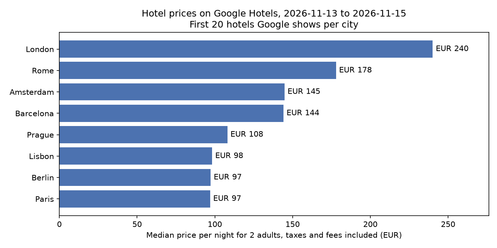

# Google Hotels API for Python

Get hotel prices from **Google Hotels** into Python for any city and dates: the nightly price, the total for your stay with taxes and fees, Google's deal note ("23% less than usual"), guest rating, review count, star class, amenities and coordinates. Google Hotels compares booking sites and the hotels' own websites, so one search gives you the going rate.

Google has no public API for reading hotel prices. Its hotel APIs are for travel partners that send their prices to Google. These examples use a hosted scraper instead, the [Google Hotels Scraper](https://apify.com/ralfij/google-hotels-scraper) on Apify, through the official Python client.



*Example output: the median price per night of the first 20 hotels Google shows in 8 cities, for 2 adults on the weekend of 13 to 15 November 2026. Made with `examples/compare_cities.py`.*

## Quick start

1. Create a free [Apify account](https://console.apify.com/sign-up). The free plan includes $5 of credit every month, which covers more than 1,000 hotel prices. No credit card needed.
2. Copy your API token from **Settings > API & Integrations** in Apify Console.
3. Run an example:

```bash
pip install -r requirements.txt
export APIFY_TOKEN=your-token        # Windows: set APIFY_TOKEN=your-token
python examples/search_hotels.py
```

```
hotel                                      stars rating  a night, all-in
The Central House Lisbon Baixa                 2    4.3           53 EUR
Lisbon Wine House - Rooms & Suites             3    3.7           68 EUR
Next Level Premium Hotels Lisbon               3    4.7           76 EUR
Novotel Lisboa                                 4      4           83 EUR
...
Saved 20 hotels to hotels.csv
```

## Examples

| File | What it does |
|---|---|
| [`examples/search_hotels.py`](examples/search_hotels.py) | Hotels for one city and date range, cheapest first, saved as CSV |
| [`examples/compare_cities.py`](examples/compare_cities.py) | The same dates in several cities, with the chart above |
| [`examples/cheapest_weekend.py`](examples/cheapest_weekend.py) | Prices for the next 8 weekends, to find the cheapest one |
| [`examples/price_tracker.py`](examples/price_tracker.py) | Run it daily: keeps a price history and lists hotels that got at least 10% cheaper |

[`sample-output/hotels-lisbon-2026-11-13.csv`](sample-output/hotels-lisbon-2026-11-13.csv) shows the CSV from `search_hotels.py`.

### Finding the cheapest weekend

`cheapest_weekend.py` for Amsterdam, run on 10 October 2026:

```
Fri 16 Oct to Sun 18 Oct: median EUR 191, cheapest EUR 97 a night
Fri 23 Oct to Sun 25 Oct: median EUR 302, cheapest EUR 28 a night
Fri 30 Oct to Sun 01 Nov: median EUR 140, cheapest EUR 88 a night
Fri 06 Nov to Sun 08 Nov: median EUR 177, cheapest EUR 104 a night
Fri 13 Nov to Sun 15 Nov: median EUR 135, cheapest EUR 96 a night
Fri 20 Nov to Sun 22 Nov: median EUR 133, cheapest EUR 89 a night
Fri 27 Nov to Sun 29 Nov: median EUR 141, cheapest EUR 86 a night
Fri 04 Dec to Sun 06 Dec: median EUR 132, cheapest EUR 78 a night

Cheapest weekend: 04 December (median EUR 132 a night, taxes included)
```

The weekend of 23 October costs more than twice as much as the cheapest one. That's the Amsterdam Dance Event, which runs from 21 to 25 October.

## What you get per hotel

- `pricePerNight` as Google shows it, and `totalPrice` for the whole stay with taxes and fees, plus `totalPriceBeforeTaxes` and `taxesAndFees` when Google shows the split
- `dealText`, such as "23% less than usual"
- `rating`, `reviewCount`, `hotelClass` (stars) and `propertyType` (hotel, hostel, vacation rental and so on)
- `amenities`, `description`, `checkInTime` and `checkOutTime`
- `latitude`, `longitude`, `website`, `googleHotelsUrl` and `googleMapsUrl`
- `hotelId`, Google's id for the property, to match hotels across runs

## Good to know

- **Taxes:** Google shows US visitors nightly prices before taxes, and most other markets prices with taxes. For prices you can compare, use `totalPrice / nights`, as the examples do.
- **About 20 hotels per search:** that's Google's first page. For more hotels in a city, add searches such as `hotels in Amsterdam Jordaan` or `hotels near Amsterdam Centraal`.
- **Relative dates:** `30 days` and `32 days` keep scheduled runs pointing at the future. To track one stay over time, use fixed dates instead.
- **Market:** the `country` input (Google's `gl` setting) decides which booking sites Google compares, and prices can differ between markets.
- **How it works:** the scraper loads the same Google Hotels search page you see in a browser, without a browser, reads the hotel list from the data in the page, and retries from fresh residential IPs when Google blocks a request.

## Other options

- **SerpApi** has a Google Hotels endpoint, with a monthly subscription.
- **Booking sites' own APIs** are usually only for partners and affiliates, and only cover their own prices.

## Use it from AI assistants (MCP)

To let Claude, Cursor, VS Code or another MCP client look up hotel prices for you, add this MCP server URL: `https://mcp.apify.com/?tools=ralfij/google-hotels-scraper`. Sign in to Apify when the client asks, or send your Apify API token as `Authorization: Bearer <token>`. Runs are billed to your own Apify account.

## Notes

- I built the Google Hotels Scraper used in these examples, so keep that in mind.
- Pricing is per hotel with no subscription; see the [actor page](https://apify.com/ralfij/google-hotels-scraper).
- It returns business data only. Guest reviews and reviewer names are left out on purpose.
- Not affiliated with, endorsed by or sponsored by Google. Google Hotels is a trademark of Google LLC.

## License

MIT
